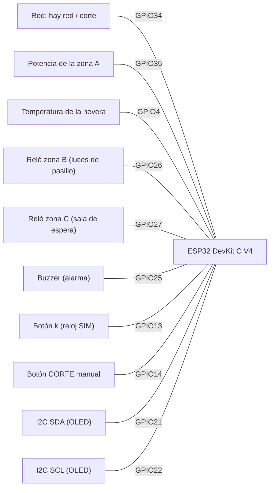

# Esquema del circuito

Generado por `tools/gen_pinout.py` a partir de `wokwi/diagram.json`.

> El esquema de Cirkit no se puede editar desde este repo; el proyecto real está en
> <https://app.cirkitdesigner.com/project/4e224752-621d-45eb-b841-17e5f0f924d7>
> (protoboard, con el INA219 en lugar del potenciómetro). Este archivo es la
> exportación en texto, para revisar que las etiquetas coincidan con `docs/PINOUT.md`.

## Señales del ESP32

## Todas las conexiones

Fuente: `wokwi/diagram.json` (incluye alimentación, GND y el cableado relé→LED).

| Desde | Hasta | Color |
|---|---|---|
| `esp:TX` | `$serialMonitor:RX` | — |
| `esp:RX` | `$serialMonitor:TX` | — |
| `sw_grid:2` | `esp:34` | green |
| `sw_grid:1` | `esp:3V3` | red |
| `sw_grid:3` | `esp:GND.2` | black |
| `pot_a:SIG` | `esp:35` | violet |
| `pot_a:VCC` | `esp:3V3` | red |
| `pot_a:GND` | `esp:GND.2` | black |
| `temp1:VCC` | `esp:3V3` | red |
| `temp1:GND` | `esp:GND.1` | black |
| `temp1:DQ` | `esp:4` | orange |
| `r_ds:2` | `temp1:DQ` | orange |
| `r_ds:1` | `esp:3V3` | red |
| `relay_b:VCC` | `esp:3V3` | red |
| `relay_b:GND` | `esp:GND.3` | black |
| `relay_b:IN` | `esp:26` | blue |
| `relay_b:COM` | `esp:3V3` | red |
| `relay_b:NO` | `led_b:A` | green |
| `led_b:C` | `r_led_b:1` | green |
| `r_led_b:2` | `esp:GND.3` | black |
| `relay_c:VCC` | `esp:3V3` | red |
| `relay_c:GND` | `esp:GND.3` | black |
| `relay_c:IN` | `esp:27` | blue |
| `relay_c:COM` | `esp:3V3` | red |
| `relay_c:NO` | `led_c:A` | gold |
| `led_c:C` | `r_led_c:1` | gold |
| `r_led_c:2` | `esp:GND.3` | black |
| `oled1:VCC` | `esp:3V3` | red |
| `oled1:GND` | `esp:GND.3` | black |
| `oled1:SDA` | `esp:21` | green |
| `oled1:SCL` | `esp:22` | blue |
| `bz1:1` | `esp:GND.1` | black |
| `bz1:2` | `esp:25` | orange |
| `btn_k:1.r` | `esp:13` | blue |
| `btn_k:2.l` | `esp:GND.1` | black |
| `btn_outage:1.r` | `esp:14` | red |
| `btn_outage:2.l` | `esp:GND.2` | black |

## Hardware real: INA219 (futuro)

En la maqueta real el potenciómetro se reemplaza por el **INA219**, compartiendo el bus
I²C de la OLED (SDA GPIO21, SCL GPIO22) en la dirección **0x40**, con VIN+/VIN− en serie
con la carga de la zona A (puntos A3/A4 de la protoboard). Wokwi no tiene ese componente,
así que la simulación usa el potenciómetro en GPIO35.
